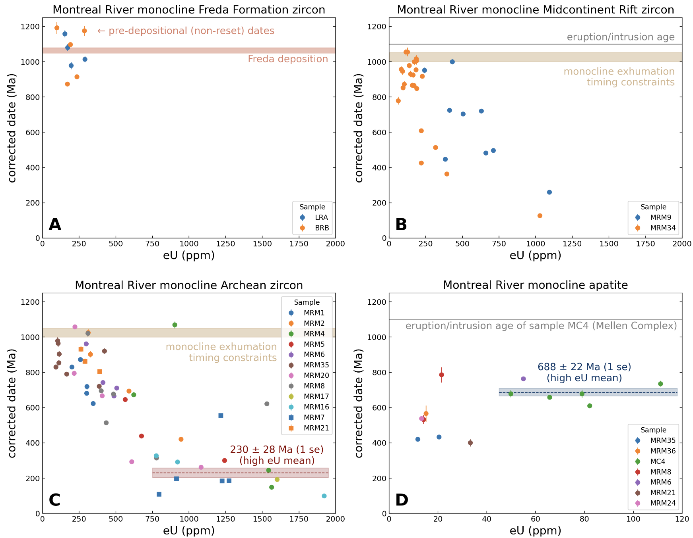

# Montreal River Monocline Thermochronology

Data analysis and modeling code for study on the thermochronology of the Montreal River monocline in northern Wisconsin associated with the manuscript:

Alemu, T. B., Guenthner, W. R., & Swanson-Hysell, N. L. (2025). Mesoproterozoic, Neoproterozoic, and Mesozoic erosion of the Montreal River monocline in the Laurentia midcontinent. *in prep for Geochemistry, Geophysics, Geosystems*.

## Code

The [code](code/) folder contains the notebooks and scripts for the project (notebook paths are relative to the folder; the scripts write output to [figures](figures/) regardless of where they are run from):

- [MRM_UTh_He_data.ipynb](code/MRM_UTh_He_data.ipynb) This notebook imports the reduced apatite and zircon (U-Th)/He data developed for the project directly from the https://github.com/wrguenthner/HAL_data repository. Within the https://github.com/wrguenthner/HAL_data/tree/main/projects_2023/TA23_MRM_MCR subdirectory of that repository are the raw datafiles and associated processing notebooks. The imported data are exported to [data](data/) and plots of these data are developed in the notebook including the main data figure of the paper:

- [MRM_forward_models.ipynb](code/MRM_forward_models.ipynb) This notebook implements forward model scenarios using the `pythermo` package that can be compared to the apatite and zircon (U-Th)/He data. The code in this notebook generates the forward model figures of the manuscript.

- [freda_zhe_burial_bound.py](code/freda_zhe_burial_bound.py) This script forward models (with `pythermo`) the survival of pre-depositional He in Freda Formation detrital zircon to bound peak Neoproterozoic burial temperatures, and the syn-depositional burial of sample BRb-1.2 to bound the syn-rift geothermal gradient (supplementary figures S2 and S3).

- [clumped_reordering_bound.py](code/clumped_reordering_bound.py) This script forward models solid-state clumped isotope reordering in ca. 1049 Ma vein calcite to bound peak Neoproterozoic burial temperatures (supplementary figure S4). It depends on ClumpyCool, included as a clone of https://github.com/maxmansaxman/Clumpy_reordering_model_distribution within the code folder.

- [make_UTh_He_tables.py](code/make_UTh_He_tables.py) This script converts the reduced data files in [data](data/) into the LaTeX supporting information data tables [si_UTh_He_zircon_table.tex](si_materials/si_UTh_He_zircon_table.tex) and [si_UTh_He_apatite_table.tex](si_materials/si_UTh_He_apatite_table.tex), which are input by the supporting information document [si_materials.tex](si_materials/si_materials.tex). It applies the same sample naming and grain filtering as the notebooks, flags the grains that are excluded as spurious or that are not part of the inversion input, and reports the Fish Canyon Tuff zircon and Durango apatite standards run in the same analytical sessions.

## Thermochron.jl inversion

The [inversion_files](inversion_files/) folder contains the input and output files for the Bayesian time-temperature inversions conducted with [Thermochron.jl](https://github.com/OpenThermochronology/Thermochron.jl): the inversion script `tTinversion_mrm.jl`, the input data file `mrm.csv`, and dated run folders that each hold a pinned Julia environment (`Project.toml`/`Manifest.toml`), a README describing the runs, and the output plots. The full posteriors (`.jld2`) are not archived, but every chain is exactly reproducible from its recorded random seed and pinned environment. The posterior path-density maps of the August 2026 chains are archived as 8-bit PNG images (`*_tT_density.png`) alongside the run outputs, exported from the posteriors by `export_tT_density.jl`. The composite inversion figures for the manuscript (`figures/inversion_tT_1500Ma.png` for the main text, and `figures/inversion_tT.png`, `figures/inversion_seed_comparison.png`, and `figures/inversion_grain_sensitivity.png` over the full model span) are assembled from these density maps by [make_inversion_figures.py](code/make_inversion_figures.py).

## Data

The [data](data/) folder contains the reduced single-grain apatite and zircon (U-Th)/He data tables and the [figures](figures/) folder contains the figures output by the notebooks and scripts.
